# AfyaQueue 🩺

<p align="center">
  
</p>

<p align="center">
  <b>Moi Teaching and Referral Hospital (MTRH Eldoret) Outpatient Portal & Real-Time Queue Dispatch System</b><br />
  <i>"Skip the physical waiting room. Track your clinical turn live from your mobile device."</i>
</p>

<p align="center">
  
  
  
  
  
</p>

---

## 📑 Table of Contents

1. [Executive Summary](#-executive-summary)
2. [Complete Visual Workflow Gallery (14 Screens)](#-complete-visual-workflow-gallery)
   - [Workflow 1: Onboarding, Splash & Authentication](#workflow-1-onboarding-splash--authentication)
   - [Workflow 2: Doctor Discovery & Atomic Queue Booking](#workflow-2-doctor-discovery--atomic-queue-booking)
   - [Workflow 3: Patient Appointments, Rescheduling & Feedback](#workflow-3-patient-appointments-rescheduling--feedback)
   - [Workflow 4: Clinic Staff Desk & Facility Broadcasting](#workflow-4-clinic-staff-desk--facility-broadcasting)
   - [Workflow 5: Patient Records & Profile Preferences](#workflow-5-patient-records--profile-preferences)
3. [System Architecture & Reactive Dataflow](#-system-architecture--reactive-dataflow)
4. [Mathematical Core & Queue Algorithms](#-mathematical-core--queue-algorithms)
5. [Backend & Security Specifications](#-backend--security-specifications)
6. [Getting Started & Local Emulation](#-getting-started--local-emulation)
7. [Repository Organization & File Tree](#-repository-organization--file-tree)
8. [Documentation Hub](#-documentation-hub)

---

## 🏥 Executive Summary

Outpatient departments in tertiary hospitals frequently suffer from crowded waiting rooms, unpredictable wait times, and manual paper-slip callouts. **AfyaQueue** solves this problem for **Moi Teaching & Referral Hospital (MTRH)** by pairing a consumer-grade mobile appointment booking experience for patients with a real-time queue dispatch console for clinic staff.

* **Guaranteed Consecutive Tokens**: Every patient receives a sequentially numbered token ($Q_{\text{patient}}$) assigned via atomic database transactions.
* **Synchronized Live Dispatch**: When a receptionist or triage nurse taps *"Call Next Patient"*, all connected patient devices update within $1\text{–}2\text{ seconds}$ without manual polling.
* **Dynamic Wait Telemetry**: Live countdowns ($N_{\text{ahead}} = \max(0, Q_{\text{patient}} - Q_{\text{serving}} - 1)$) and estimated wait times adjusted dynamically by clinician specialty.

---

## 📱 Complete Visual Workflow Gallery

The application consists of 14 pixel-perfect screens adhering to the **AfyaQueue Clinical Motion** design system (`#1E7A46` Forest Green, `#2752B7` Royal Blue, `#F27438` Vibrant CTA Orange, and sanitized `#F8FAFC` base neutral).

### Workflow 1: Onboarding, Splash & Authentication

The onboarding journey guides patients and clinic staff through institutional authentication, hospital registration number lookups, and session routing.

<table>
  <tr>
    <td align="center" width="33%">
      <b>1.8s Vital Bypass Splash</b><br/><br/>
      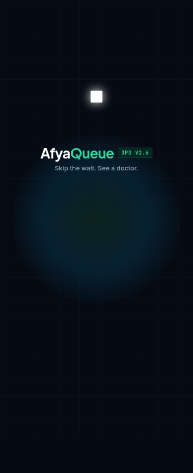<br/><br/>
      <i>Institutional launch sequence with automatic role routing.</i>
    </td>
    <td align="center" width="33%">
      <b>Role-Based Login</b><br/><br/>
      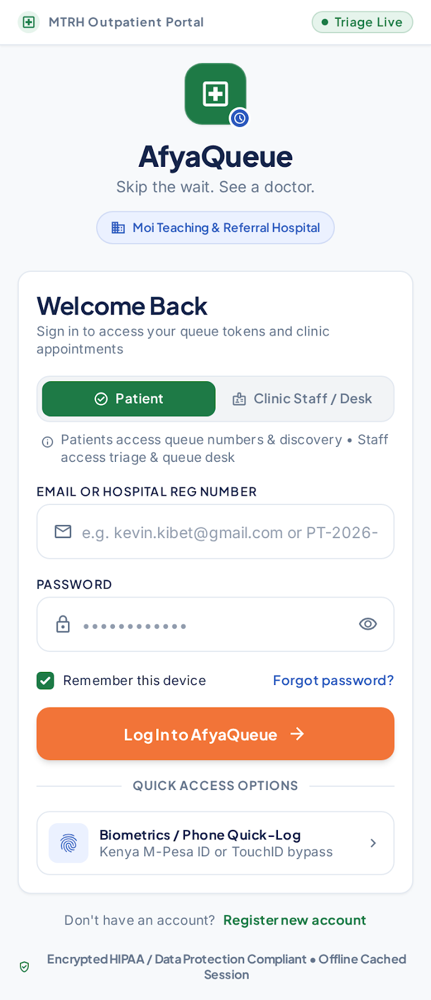<br/><br/>
      <i>Patient or Staff chip toggle with reg. number login support.</i>
    </td>
    <td align="center" width="33%">
      <b>Registration & Hospital ID</b><br/><br/>
      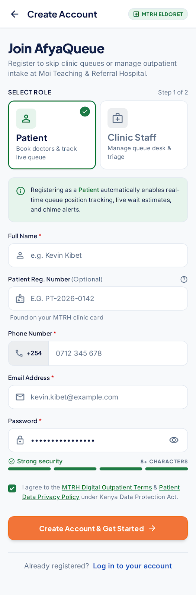<br/><br/>
      <i>MTRH patient registration number generation and role gating.</i>
    </td>
  </tr>
  <tr>
    <td valign="top">
      <ul>
        <li>Routes to <code>/(tabs)/discover</code> for patients or <code>/(tabs)/desk</code> for clinic staff.</li>
        <li>Checks cached credentials in <code>AsyncStorage</code> for instant bypass.</li>
      </ul>
    </td>
    <td valign="top">
      <ul>
        <li>Supports email or MTRH Reg No (<code>PT-2026-0142</code>).</li>
        <li>Biometric Quick Bypass button with instant haptic confirmation.</li>
      </ul>
    </td>
    <td valign="top">
      <ul>
        <li>Dual-role chip selection (Patient vs Staff).</li>
        <li>Issues unique patient registration number linked to Firebase Auth UID.</li>
      </ul>
    </td>
  </tr>
</table>

---

### Workflow 2: Doctor Discovery & Atomic Queue Booking

Patients browse clinicians, inspect available consultation windows with automatic booked-slot filtering, and claim their queue number atomically.

<table>
  <tr>
    <td align="center" width="33%">
      <b>Doctor Discovery</b><br/><br/>
      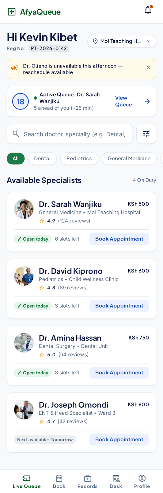<br/><br/>
      <i>Specialty filter chips & live remaining slots counter.</i>
    </td>
    <td align="center" width="33%">
      <b>Time Slot Selection</b><br/><br/>
      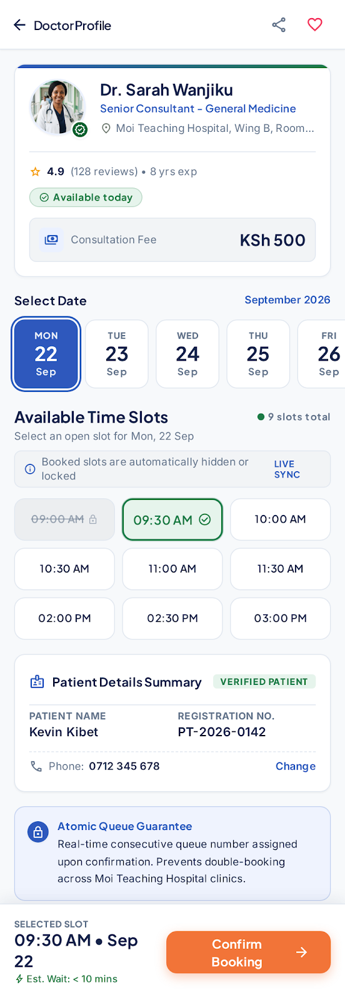<br/><br/>
      <i>Dynamic slot grid hiding already-booked consultation slots.</i>
    </td>
    <td align="center" width="33%">
      <b>Live Queue Tracker</b><br/><br/>
      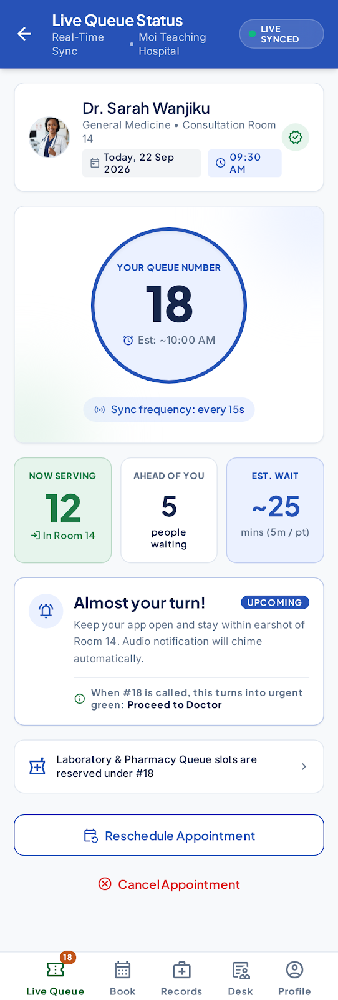<br/><br/>
      <i>180px circular centerpiece with real-time ETA and turn alert.</i>
    </td>
  </tr>
  <tr>
    <td valign="top">
      <ul>
        <li>Search by clinician name, specialty, or hospital wing.</li>
        <li>Specialty filter chips: <i>All, Dental, Pediatrics, General Medicine, ENT</i>.</li>
        <li>Shows fee (e.g. <code>KSh 500</code>) and live open slots.</li>
      </ul>
    </td>
    <td valign="top">
      <ul>
        <li>Dynamic formula excludes already-booked slots for chosen date.</li>
        <li>Executes Firestore <code>runTransaction</code> to guarantee no double-booking.</li>
      </ul>
    </td>
    <td valign="top">
      <ul>
        <li>Displays <b>YOUR NUMBER (#18)</b> and <b>Now Serving (#12)</b>.</li>
        <li>Live countdown: <i>5 people ahead · ~25 mins wait</i>.</li>
        <li>Active turn banner triggers when $Q_{\text{patient}} == Q_{\text{serving}}$.</li>
      </ul>
    </td>
  </tr>
</table>

---

### Workflow 3: Patient Appointments, Rescheduling & Feedback

Comprehensive appointment management allowing patients to track previous consultations, reschedule upcoming appointments atomically, and rate medical staff.

<table>
  <tr>
    <td align="center" width="33%">
      <b>My Appointments</b><br/><br/>
      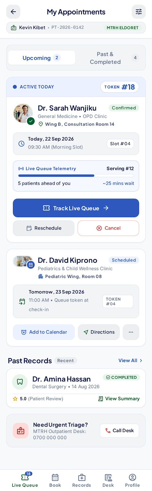<br/><br/>
      <i>Upcoming & Past visit tabs with active queue telemetry.</i>
    </td>
    <td align="center" width="33%">
      <b>Reschedule Modal Flow</b><br/><br/>
      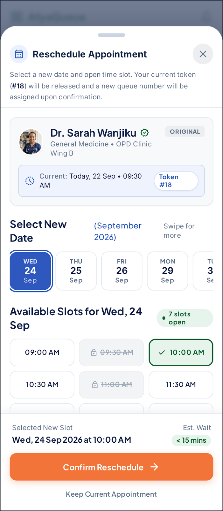<br/><br/>
      <i>Atomic slot release and sequential token re-issuance.</i>
    </td>
    <td align="center" width="33%">
      <b>Doctor Visit Rating</b><br/><br/>
      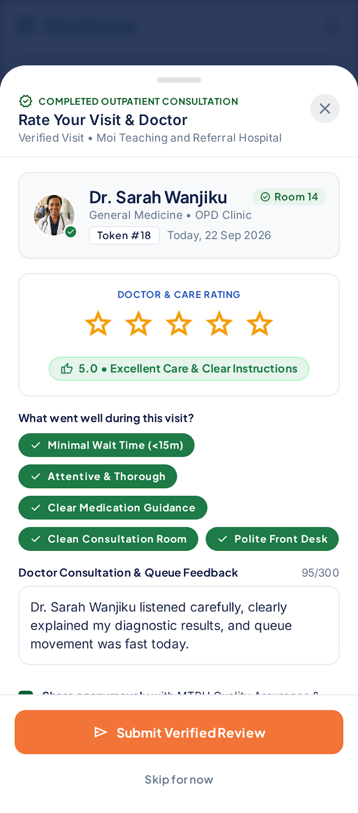<br/><br/>
      <i>1–5 star rating with tag pills and aggregate recalculation.</i>
    </td>
  </tr>
  <tr>
    <td valign="top">
      <ul>
        <li>Segmented control between <b>Upcoming</b> and <b>Past Visits</b>.</li>
        <li>Quick action triggers: <code>View Live Queue</code>, <code>Reschedule</code>, <code>Cancel</code>.</li>
      </ul>
    </td>
    <td valign="top">
      <ul>
        <li>Single atomic transaction: releases old slot and claims new slot.</li>
        <li>Automatically updates active queue pointer in local cache.</li>
      </ul>
    </td>
    <td valign="top">
      <ul>
        <li>Submits feedback for completed clinic consultations.</li>
        <li>Updates doctor's rolling average rating and review count in Firestore.</li>
      </ul>
    </td>
  </tr>
</table>

---

### Workflow 4: Clinic Staff Desk & Facility Broadcasting

Clinic receptionists and triage nurses monitor real-time queue streams, dispatch the next patient with single-tap triggers, register doctors, and broadcast hospital notices.

<table>
  <tr>
    <td align="center" width="33%">
      <b>Staff Live Queue Desk</b><br/><br/>
      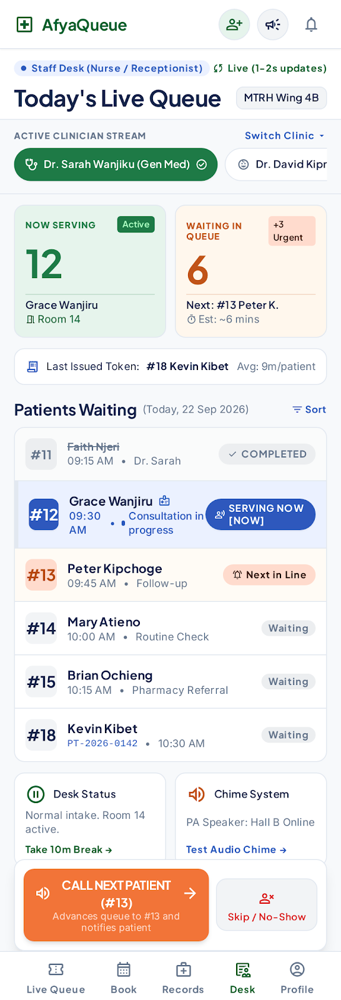<br/><br/>
      <i>Doctor tabs, Serving & Waiting counters, Call Next CTA.</i>
    </td>
    <td align="center" width="33%">
      <b>Add Doctor / Service Desk</b><br/><br/>
      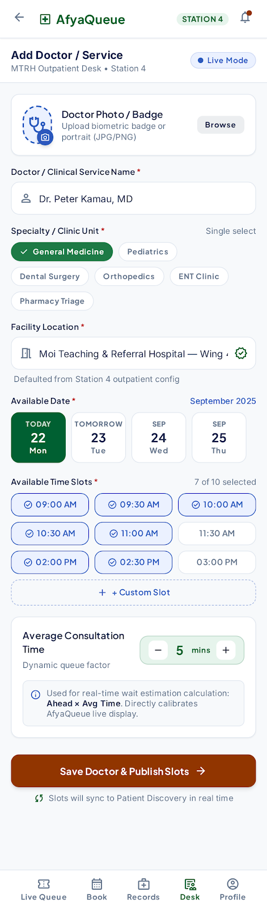<br/><br/>
      <i>Staff clinician setup with toggleable time slot chips.</i>
    </td>
    <td align="center" width="33%">
      <b>Facility Announcements</b><br/><br/>
      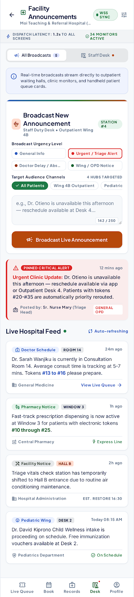<br/><br/>
      <i>Urgent outpatient hall alerts with real-time push.</i>
    </td>
  </tr>
  <tr>
    <td valign="top">
      <ul>
        <li>Top clinician selector tabs (Dr. Sarah, Dr. David, Dr. Amina, Dr. Joseph).</li>
        <li><b>Call Next Patient (#13)</b> advances $Q_{\text{serving}}$ via transaction.</li>
        <li>Displays queue list with <code>NOW</code> badge for active patient.</li>
      </ul>
    </td>
    <td valign="top">
      <ul>
        <li>Register clinician name, specialty, room number, fee, and date.</li>
        <li>Multi-select time slot pill grid (e.g. 09:00, 09:30, 10:00).</li>
        <li>Initializes clean <code>queueStatus</code> counter document.</li>
      </ul>
    </td>
    <td valign="top">
      <ul>
        <li>Dispatches urgent hospital announcements (e.g. doctor unavailability).</li>
        <li>Instant broadcast via Firestore real-time snapshot listeners.</li>
      </ul>
    </td>
  </tr>
</table>

---

### Workflow 5: Patient Records & Profile Preferences

Patients can access digital consultation slips, pharmacy prescription tokens, laboratory results, and configure notification preferences.

<table>
  <tr>
    <td align="center" width="50%">
      <b>Medical Records & Prescriptions</b><br/><br/>
      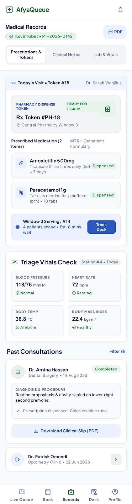<br/><br/>
      <i>Prescriptions, diagnosis summary, and laboratory results.</i>
    </td>
    <td align="center" width="50%">
      <b>User Profile & Notifications</b><br/><br/>
      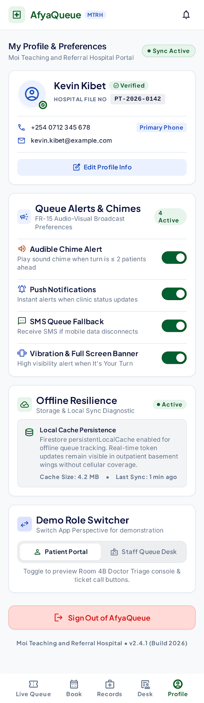<br/><br/>
      <i>SMS, Push, Audio chime toggles, and instant Role Switcher.</i>
    </td>
  </tr>
  <tr>
    <td valign="top">
      <ul>
        <li>Tabs: <b>Prescriptions</b>, <b>Visits</b>, <b>Labs</b>.</li>
        <li>Medication details: dosage, frequency, duration, and instructions.</li>
        <li>Laboratory results: FBC, serum creatinine, glucose tests.</li>
      </ul>
    </td>
    <td valign="top">
      <ul>
        <li>Notification toggles: SMS alerts, Push notifications, 2-tone audio chimes.</li>
        <li>Volume slider (0–100%) and MTRH hospital affiliation badge.</li>
        <li>Instant <b>Switch Role</b> button for seamless demo testing.</li>
      </ul>
    </td>
  </tr>
</table>

---

## 🏗️ System Architecture & Reactive Dataflow

AfyaQueue connects the client to Firebase Backend-as-a-Service (BaaS) over WebSockets and HTTPS transactions:

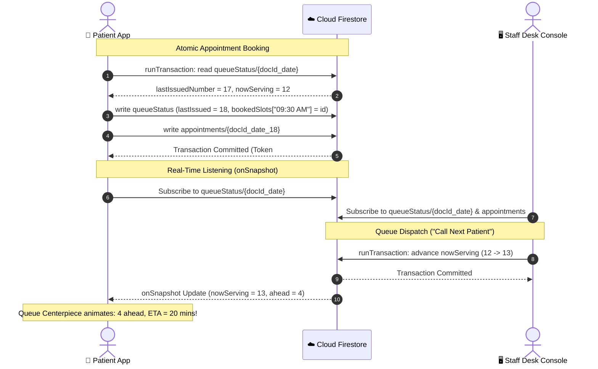

---

## 🧮 Mathematical Core & Queue Algorithms

The queue calculation engine is verified against 11 rigorous automated assertions:

| Formula Name | Mathematical Equation | Implementation in `src/types/models.ts` |
| :--- | :--- | :--- |
| **People Ahead ($N_{\text{ahead}}$)** | $N_{\text{ahead}} = \max(0, Q_{\text{patient}} - Q_{\text{serving}} - 1)$ | `calculatePeopleAhead(18, 12) === 5` |
| **Estimated Wait Time ($\text{ETA}$)**| $\text{ETA} = N_{\text{ahead}} \times T_{\text{avg}}$ | `calculateEstimatedWaitTime(5, 5) === 25 min` |
| **Active Turn Trigger** | $\text{isTurn} = (Q_{\text{patient}} > 0) \land (Q_{\text{patient}} = Q_{\text{serving}})$ | `isPatientTurn(12, 12) === true` |
| **Already Served Condition** | $\text{isPast} = (Q_{\text{patient}} > 0) \land (Q_{\text{patient}} < Q_{\text{serving}})$ | `isPatientTurnPast(11, 12) === true` |
| **Dynamic Open Slots** | $\text{OpenSlots} = \text{Slots}_{\text{total}} \setminus \text{Slots}_{\text{upcoming}}$ | Dynamic filtering in `DoctorDetailScreen` |

Run the mathematical specification test suite:
```bash
npm run test:math
# Output: 11 pass, 0 fail (21 expect() assertions)
```

---

## 🔒 Backend & Security Specifications

All database operations are governed by production-grade [firestore.rules](file:///home/elvin/Projects/tutorials/afyaque/firestore.rules):

* **Role-Based Access Control**: Safe token claim checking (`request.auth.token.get('role', '') == 'staff'`) with fallback to Firestore user profiles.
* **Slot Releasing on Cancellation**: When a patient cancels an upcoming appointment, Firestore rules permit atomic release of the slot from `queueStatus.bookedSlots` without modifying counters.
* **Deterministic IDs**: Appointments use `${doctorId}_${date}_${queueNumber}` to enforce single-token integrity.
* **31 Unit Tests**: Verified against the local Firestore Emulator:
  ```bash
  npm run test:rules
  # Output: 31 pass, 0 fail (Ran 31 tests across 1 file in 17.56s)
  ```

---

## 🚀 Getting Started & Local Emulation

### 1. Prerequisites
- **Node.js**: v20 or v22+
- **Bun**: v1.1+ (or npm)
- **Java Runtime**: JRE 17+ (required for Firebase Local Emulators)

### 2. Installation
```bash
git clone git@github.com:Elvinoacer/afyaqueue.git
cd afyaqueue
npm install
```

### 3. Local Backend Setup (Firebase Emulator Suite)
Start the local Firebase emulators:
```bash
npm run emulators
# Firebase Emulator UI available at http://localhost:4000
# Auth: 9099 | Firestore: 8080 | Functions: 5001
```

In a separate terminal, seed the database with initial clinicians, queues, and demo accounts:
```bash
npm run seed
```

### 4. Running the Mobile App
```bash
# Start Expo Metro Bundler
npm start

# Run on Android
npm run android

# Run on iOS
npm run ios

# Run on Web
npm run web
```

### 5. Verification Commands
```bash
# TypeScript strict check (0 errors)
npx tsc --noEmit

# Code style linting (0 warnings)
npm run lint

# Queue math unit tests
npm run test:math

# Firestore security rules unit tests
npm run test:rules
```

---

## 📁 Repository Organization & File Tree

The repository has been structured for clean navigation:

```
afyaqueue/
├── assets/                          # App fonts and doctor portrait images
│   ├── fonts/                       # Material Symbols Outlined & Filled TTF fonts
│   └── images/doctors/              # Clinician portraits (Dr. Sarah, Dr. David, etc.)
├── docs/                            # Organized Engineering Documentation Hub
│   ├── architecture-guide.md        # Complete system architecture specification
│   ├── backend-and-security.md      # Cloud Firestore rules, schemas, and services
│   ├── roadmap.md                   # Progress audit and production roadmap
│   └── README.md                    # Documentation index
├── screen_designs/                  # Visual mockups for all 14 screens
│   ├── afyaqueue_clinical_motion/   # Design system tokens and geometry
│   ├── patient_live_queue_tracker/  # Queue centerpiece mockup
│   └── ...                          # 14 screen mockup directories with screen.png
├── scripts/
│   ├── seed-firestore.ts            # Database seeding script (Admin SDK / Emulator)
│   └── verify-queue-math.test.ts    # Mathematical specification unit tests
├── src/
│   ├── app/                         # Expo Router screens (file-based navigation)
│   │   ├── (tabs)/                  # 5-tab dock: discover, queue, records, desk, profile
│   │   ├── announcements/           # Broadcast notice modal
│   │   ├── appointments/            # My appointments & reschedule modal
│   │   ├── auth/                    # Dual-role login & registration
│   │   ├── doctor/[id].tsx          # Clinician detail & slot booking
│   │   ├── feedback/rating.tsx      # Visit rating & review modal
│   │   └── staff/add-doctor.tsx     # Add doctor service modal
│   ├── components/ui/               # 12 reusable design system primitives
│   ├── lib/                         # Firebase SDK bootstrap & auth persistence
│   ├── services/                    # Real-time backend data services
│   │   ├── authService.ts           # Authentication & reg number lookup
│   │   ├── bookingService.ts        # Atomic queue booking, reschedule, call next
│   │   ├── doctorService.ts         # Clinician listing & creation
│   │   ├── announcementService.ts   # Hospital broadcast notices
│   │   ├── ratingService.ts         # Patient consultation ratings
│   │   └── medicalRecordService.ts  # Prescriptions and lab records
│   ├── store/                       # Dual-role AppProvider state management
│   ├── theme/                       # Colors, metrics, typography, shadows
│   └── types/                       # Shared TypeScript models and formulas
├── tests/
│   └── rules/firestore.rules.test.ts # 31 Firestore security rules tests
├── firebase.json                    # Firebase emulator & rules configuration
├── firestore.indexes.json           # Composite query indexes
└── firestore.rules                  # Production Cloud Firestore security rules
```

---

## 📚 Documentation Hub

* 📖 **[System Architecture Guide](file:///home/elvin/Projects/tutorials/afyaque/docs/architecture-guide.md)**
* 🔐 **[Backend & Firestore Security Rules Guide](file:///home/elvin/Projects/tutorials/afyaque/docs/backend-and-security.md)**
* 🎨 **[AfyaQueue Clinical Motion Design System](file:///home/elvin/Projects/tutorials/afyaque/screen_designs/afyaqueue_clinical_motion/DESIGN.md)**
* 🗺️ **[Production Roadmap & Milestone Audit](file:///home/elvin/Projects/tutorials/afyaque/docs/roadmap.md)**

---

## 📄 License & Institutional Rights

Private & Institutional — **Moi University School of Medicine** / **Moi Teaching and Referral Hospital (MTRH Eldoret)**. All rights reserved.
